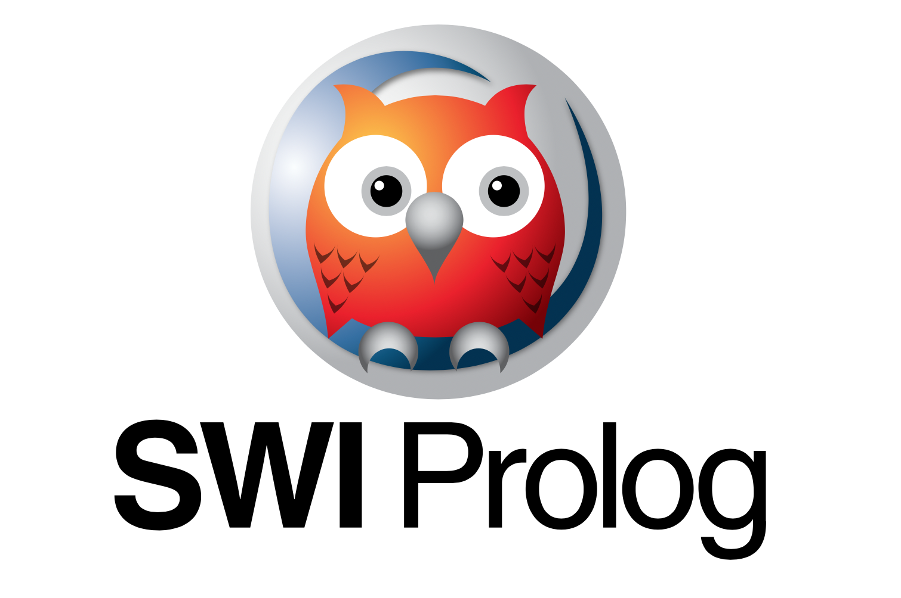

[← Voltar ao repositório principal](../../../README.md) • [🌐 Site do Portfólio](https://rafaelmm16.github.io/College/)

# Lógica para Computação II

> **Área:** Estruturas de Dados & Teoria · **Linguagem:** Prolog · **Ano:** 2020



## 📖 Sobre

Estudos, exercícios e projetos da disciplina de **Lógica para Computação II**, voltados à **Programação em Lógica Matemática** utilizando **Prolog** (fatos, regras, unificação, backtracking e inferência lógica).

## 📂 Conteúdo da Pasta

- `Exemplos/` — exemplos introdutórios e consultas em Prolog.
- `Projetos/` — projetos práticos desenvolvidos na disciplina.
- `Mundo_Ninja.pl` — base de conhecimento e regras em Prolog.
- `estudo.txt` e `exercicios-sbc.pdf` — anotações e lista de exercícios.

## 🚀 Como Executar

Requer [SWI-Prolog](https://www.swi-prolog.org/) instalado:

```bash
swipl Mundo_Ninja.pl
```
