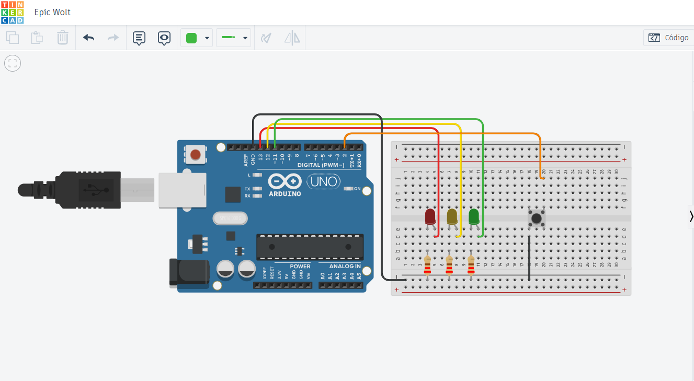

[← Voltar ao repositório principal](../../../README.md) • [🌐 Site do Portfólio](https://rafaelmm16.github.io/college/)

# Projeto Integrador VI-B — Simulador de Semáforo com Arduino

> **Área:** Projetos Integradores & Sistemas · **Linguagem:** C++ (Arduino) · **Ano:** 2024

## 📖 Sobre o Projeto

Simulador de semáforo desenvolvido no **Tinkercad** para a disciplina **Projeto Integrador VI-B**, utilizando **Arduino Uno**, LEDs (vermelho, amarelo e verde) e um botão de travessia para pedestres.

## ⚙️ Funcionamento

O semáforo opera em ciclo contínuo com os tempos:

- **Vermelho:** 5 segundos
- **Amarelo:** 2 segundos
- **Verde:** 5 segundos

Ao pressionar o botão de pedestre:

1. Se o LED verde estiver aceso, ele é desligado e o amarelo acende por 2 segundos.
2. Em seguida, o LED vermelho acende por 5 segundos para permitir a travessia segura.
3. Após a travessia, o ciclo normal é retomado.

## 🧩 Componentes Utilizados

- Arduino Uno R3
- 3 LEDs (vermelho, amarelo e verde)
- 3 resistores de 220 Ω
- 1 botão de pressão (*Push Button*)
- Protoboard e jumpers

## 📂 Conteúdo da Pasta

- `epic_wolt1.ino` — código-fonte em C++ (Arduino).
- `semaforo.png` — diagrama do circuito no Tinkercad.
- `LICENSE` — licença do projeto.
